# Galeria de visualizações — Partes 1 e 2

Gerada por `analysis/plot_graphs.py` a partir dos dados coletados e dos resultados salvos do Azure.
A geração das figuras não executa Dijkstra, análises integrais dos grafos nem novas repetições dos benchmarks.

## Regenerar

```bash
make figures
make test-visualizations
```

O interpretador Python precisa de Matplotlib, NumPy, NetworkX e SciPy, já disponíveis no ambiente local atual. São ferramentas opcionais de visualização; a biblioteca C++ e o coletor não dependem delas. Use `make figures PYTHON=/caminho/do/python` para selecionar outro ambiente. O script não instala pacotes.

As figuras são salvas em SVG editável e PNG de 160 dpi em `docs/figures/`, para uso posterior na apresentação. Execute os comandos na raiz do repositório. Opções: `python3 analysis/plot_graphs.py --help`.

As distribuições exatas incluem todos os vértices e arestas. Dados discretos, como graus e tamanhos de componentes, são representados apenas por pontos, sem segmentos de ligação. As imagens das redes usam amostras limitadas e não estimam propriedades globais. Os diâmetros em número de arestas nos dados de origem desconsideram pesos; o resultado da dupla varredura é um limite inferior restrito à maior componente.

`figures/provenance.json` registra hashes dos dados de entrada e do executável, commits da biblioteca, versões das ferramentas e hashes das figuras. O ambiente do Azure e o número de amostras dos tempos aparecem abaixo.

## Resumo estrutural

Laços são descartados pelo leitor e contados separadamente. CSR preserva arestas paralelas.

| Grafo | Vértices | Arestas | Componentes | Maior componente (%) | Laços descartados | Paralelas |
| --- | ---: | ---: | ---: | ---: | ---: | ---: |
| Grafo 1 | 10,000 | 109,973 | 1 | 100.0000 | 4 | 52 |
| Grafo 2 | 49,948 | 1,299,729 | 10 | 50.0521 | 65 | 1,019 |
| Grafo 3 | 375,000 | 765,617 | 2 | 66.6667 | 1 | 2 |
| Grafo 4 | 375,000 | 8,187,392 | 2 | 66.6667 | 35 | 406 |
| Grafo 5 | 4,843,750 | 13,168,921 | 5 | 51.6129 | 7 | 10 |
| Grafo 6 | 4,843,750 | 46,469,627 | 5 | 51.6129 | 43 | 148 |
| Grafo Ponderado 3 | 100,000 | 6,099,941 | 1 | 100.0000 | 0 | 73 |
| Grafo Ponderado 4 | 1,000,000 | 30,999,978 | 1 | 100.0000 | 0 | 34 |
| Grafo Ponderado 5 | 10,000,000 | 39,999,995 | 1 | 100.0000 | 0 | 4 |
| Grafo Ponderado 6 | 10,000,000 | 73,403,372 | 4 | 100.0000 | 0 | 0 |
| Grafo Ponderado 7 | 50,000,000 | 59,999,999 | 1 | 100.0000 | 0 | 0 |
| Rede de colaboração | 722,385 | 2,272,543 | 77,486 | 79.7786 | 0 | 0 |

## Graus e diâmetros em arestas

| Grafo | Grau mínimo | Mediana | Média | Máximo | Diâmetro / limite |
| --- | ---: | ---: | ---: | ---: | --- |
| Grafo 1 | 8 | 22 | 21.9946 | 43 | ≥ 4 (maior componente) |
| Grafo 2 | 1 | 55 | 52.0433 | 112 | ≥ 3 (maior componente) |
| Grafo 3 | 1 | 4 | 4.08329 | 15 | ≥ 14 (maior componente) |
| Grafo 4 | 9 | 47 | 43.6661 | 89 | ≥ 4 (maior componente) |
| Grafo 5 | 1 | 5 | 5.43749 | 22 | ≥ 12 (maior componente) |
| Grafo 6 | 2 | 20 | 19.1875 | 56 | ≥ 6 (maior componente) |
| Grafo Ponderado 3 | 78 | 122 | 121.999 | 171 | ≥ 3 (maior componente) |
| Grafo Ponderado 4 | 25 | 62 | 62 | 102 | ≥ 5 (maior componente) |
| Grafo Ponderado 5 | 2 | 8 | 8 | 25 | ≥ 11 (maior componente) |
| Grafo Ponderado 6 | 0 | 15 | 14.6807 | 38 | ≥ 8 (maior componente) |
| Grafo Ponderado 7 | 1 | 2 | 2.4 | 9 | ≥ 75 (maior componente) |
| Rede de colaboração | 0 | 3 | 6.29178 | 643 | ≥ 23 (maior componente) |

## Parte 1 — Tamanho dos grafos

Quantidades de vértices e arestas não direcionadas dos grafos originais; arestas paralelas são contadas individualmente.

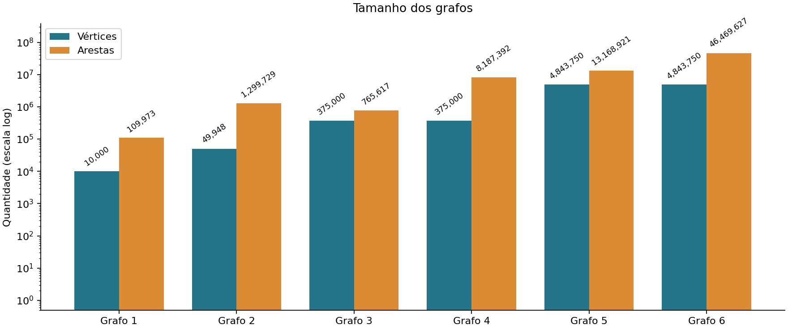

[SVG](figures/parte1/graph_sizes.svg) · [PNG](figures/parte1/graph_sizes.png)

## Parte 1 — Frequências dos graus

Frequências exatas dos graus, incluindo grau zero. Arestas paralelas contribuem para o grau. Cada ponto representa um grau discreto; não há linhas de ligação.

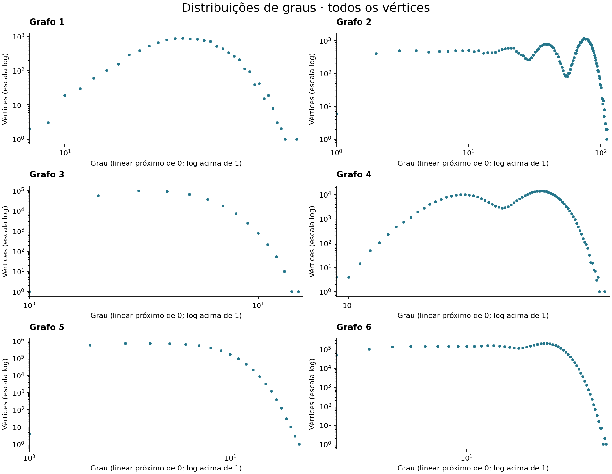

[SVG](figures/parte1/degree_frequencies.svg) · [PNG](figures/parte1/degree_frequencies.png)

## Parte 1 — Distribuições acumuladas complementares dos graus

Distribuições acumuladas complementares exatas dos graus: P(grau ≥ k). O denominador inclui todos os vértices. Os valores discretos são representados apenas por pontos.

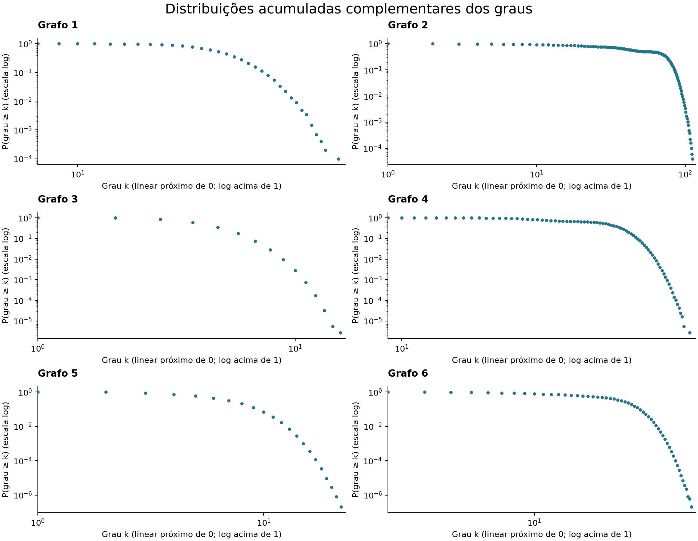

[SVG](figures/parte1/degree_tails.svg) · [PNG](figures/parte1/degree_tails.png)

## Parte 1 — Tamanhos das componentes

Frequências exatas dos tamanhos das componentes, representadas apenas por pontos. Cada ponto informa quantas componentes possuem aquele tamanho.

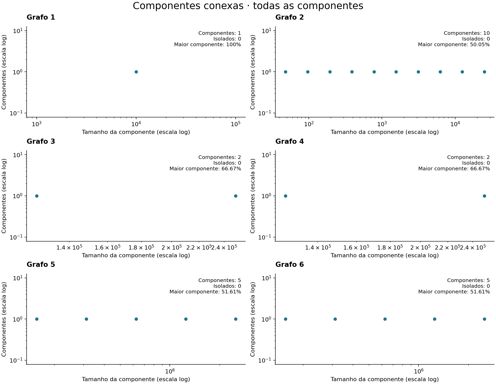

[SVG](figures/parte1/component_sizes.svg) · [PNG](figures/parte1/component_sizes.png)

## Parte 1 — Distâncias dos estudos de caso

Distâncias dos caminhos mínimos e número de arestas dos caminhos salvos. Nos grafos ponderados, as distâncias são ponderadas; nos demais, contam arestas. Destinos inalcançáveis não possuem barra nem distância zero.

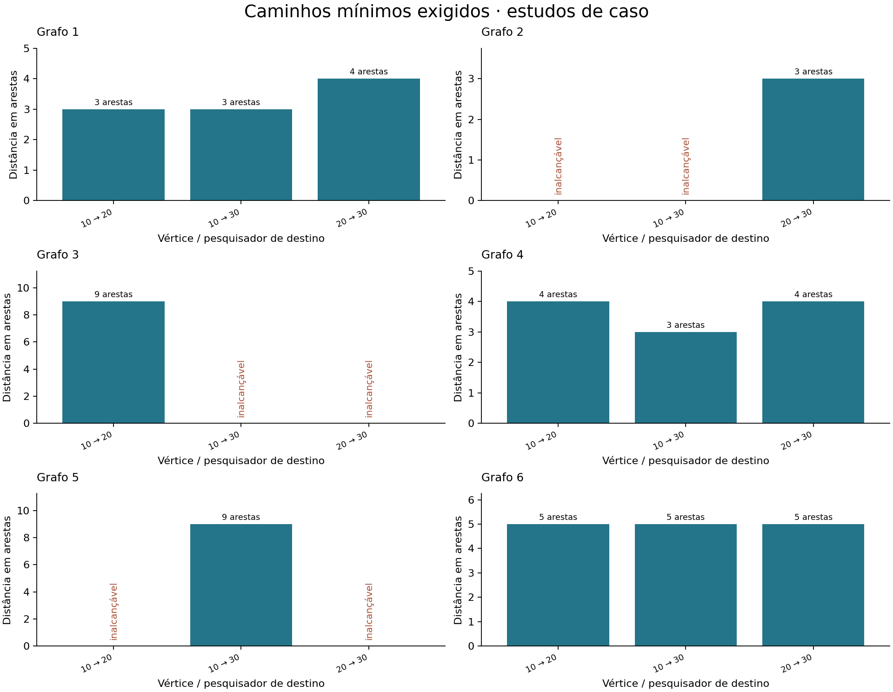

[SVG](figures/parte1/case_distances.svg) · [PNG](figures/parte1/case_distances.png)

## Parte 1 — Profundidades de BFS e DFS

Profundidades das árvores BFS e DFS nos pares exigidos. BFS fornece distâncias mínimas em arestas; a profundidade da DFS não é uma distância mínima. Destinos inalcançáveis não possuem ponto. Escala vertical linear próxima de zero e logarítmica acima de uma aresta.


[SVG](figures/parte1/search_depths.svg) · [PNG](figures/parte1/search_depths.png)

## Parte 2 — Tamanho dos grafos

Quantidades de vértices e arestas não direcionadas dos grafos originais; arestas paralelas são contadas individualmente.

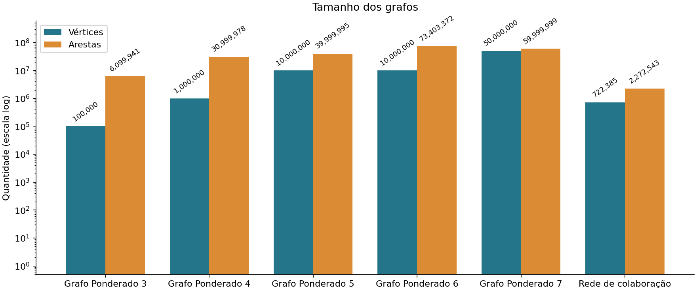

[SVG](figures/parte2/graph_sizes.svg) · [PNG](figures/parte2/graph_sizes.png)

## Parte 2 — Frequências dos graus

Frequências exatas dos graus, incluindo grau zero. Arestas paralelas contribuem para o grau. Cada ponto representa um grau discreto; não há linhas de ligação.

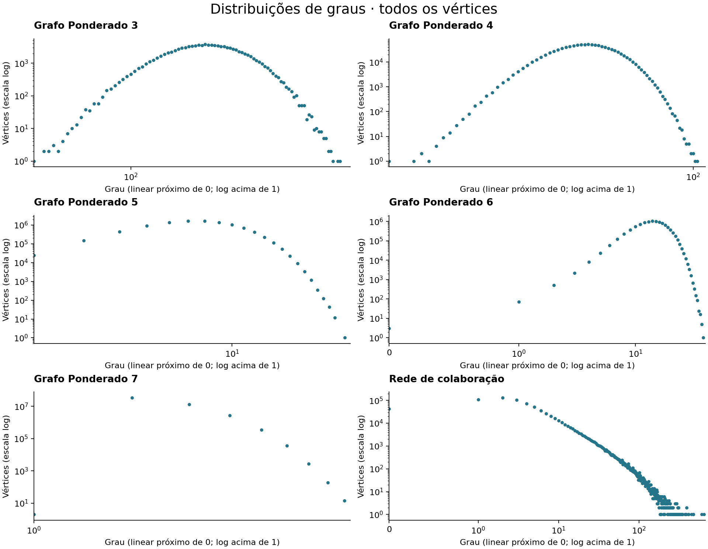

[SVG](figures/parte2/degree_frequencies.svg) · [PNG](figures/parte2/degree_frequencies.png)

## Parte 2 — Distribuições acumuladas complementares dos graus

Distribuições acumuladas complementares exatas dos graus: P(grau ≥ k). O denominador inclui todos os vértices. Os valores discretos são representados apenas por pontos.

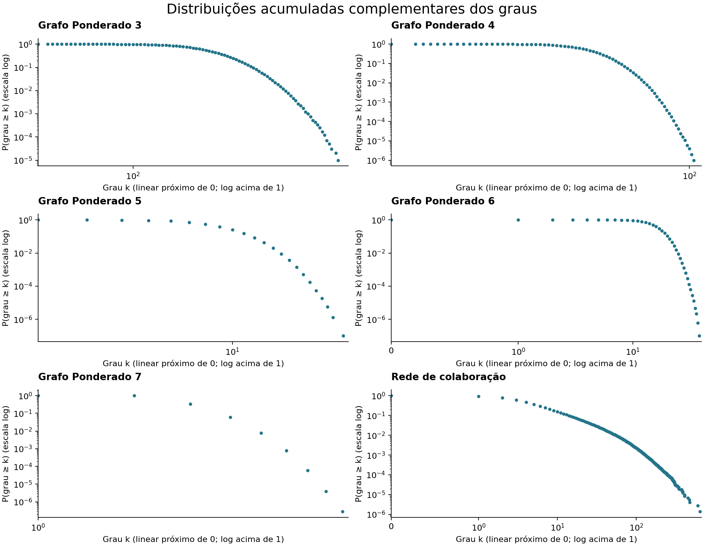

[SVG](figures/parte2/degree_tails.svg) · [PNG](figures/parte2/degree_tails.png)

## Parte 2 — Distribuições dos pesos

Histograma dos pesos nos intervalos coletados. A contagem de pesos zero é exata. A rede de colaboração usa escala log nas contagens; intervalos vazios não têm barra.

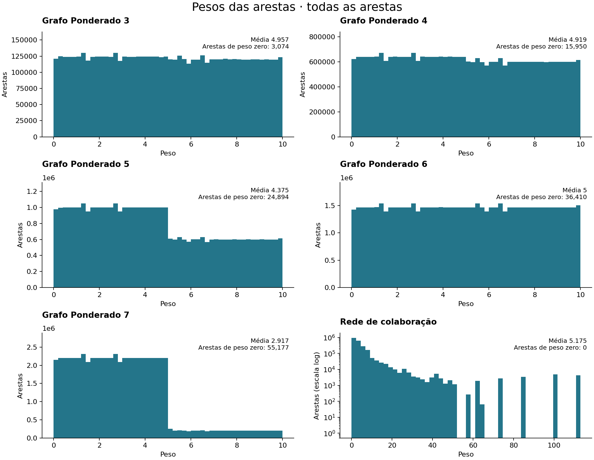

[SVG](figures/parte2/weight_distributions.svg) · [PNG](figures/parte2/weight_distributions.png)

## Parte 2 — Tamanhos das componentes

Frequências exatas dos tamanhos das componentes, representadas apenas por pontos. Cada ponto informa quantas componentes possuem aquele tamanho.

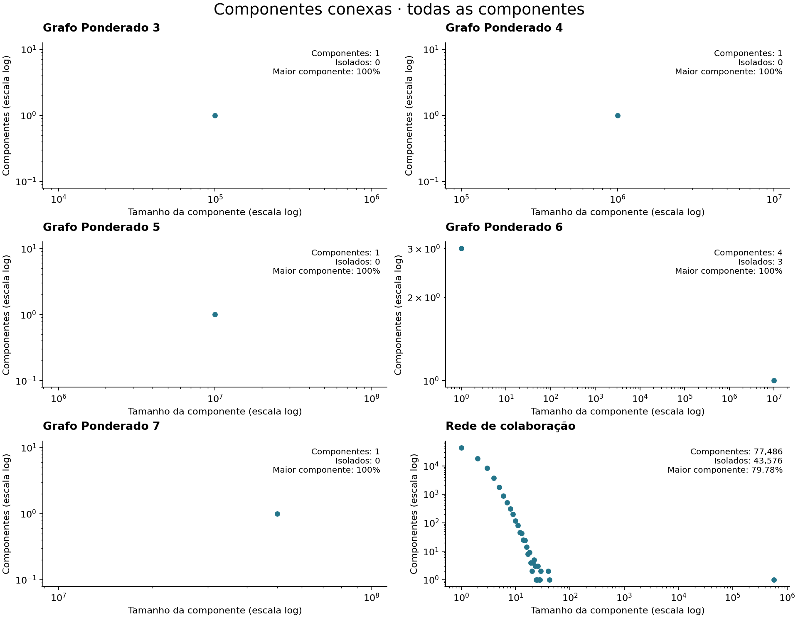

[SVG](figures/parte2/component_sizes.svg) · [PNG](figures/parte2/component_sizes.png)

## Parte 2 — Distâncias dos estudos de caso

Distâncias dos caminhos mínimos e número de arestas dos caminhos salvos. Nos grafos ponderados, as distâncias são ponderadas; nos demais, contam arestas. Destinos inalcançáveis não possuem barra nem distância zero.

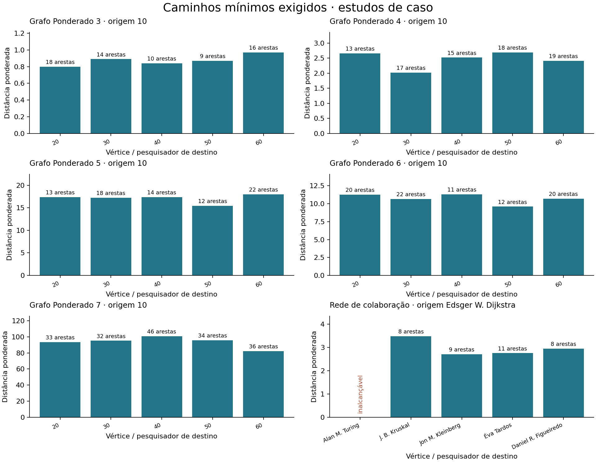

[SVG](figures/parte2/case_distances.svg) · [PNG](figures/parte2/case_distances.png)

## Parte 2 — Tempos no Azure

Médias e medianas dos tempos no Azure, convertidas de microssegundos para segundos. Há medições com vetor apenas para o Grafo Ponderado 3; barras ausentes indicam medições não realizadas. A tabela informa o número de amostras.

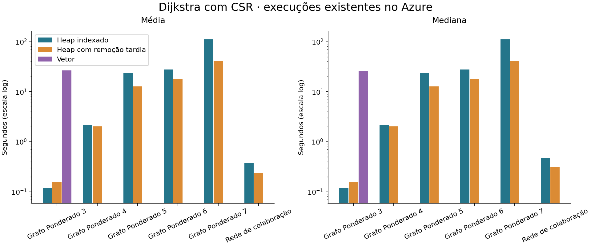

[SVG](figures/parte2/azure_timings.svg) · [PNG](figures/parte2/azure_timings.png)

## Parte 2 — Memória no Azure

RSS medido para a representação CSR no Azure. As estimativas da matriz aparecem separadamente na tabela; esses valores não representam o pico de memória de Dijkstra.

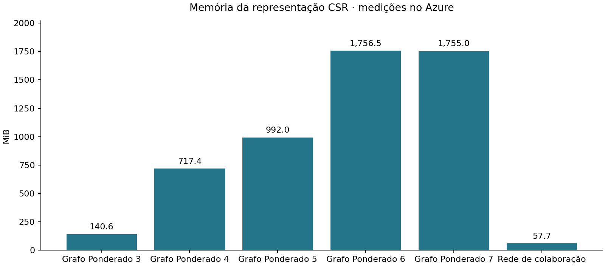

[SVG](figures/parte2/azure_memory.svg) · [PNG](figures/parte2/azure_memory.png)

## Tempos de BFS e DFS em CSR no Azure

Tempos de BFS e DFS da nova rodada no Azure. O número de origens aleatórias distintas varia por grafo e armazenamento; BFS e DFS mantêm as mesmas origens. A tabela informa os números efetivos de amostras. As buscas ignoram pesos; resultados da rodada anterior de Dijkstra aparecem separadamente.


[SVG](figures/azure_traversals.svg) · [PNG](figures/azure_traversals.png)

## Comparação CSR e matriz com bitmask no Azure

Comparação de BFS e DFS em CSR e matriz com bitmask nos grafos 1 a 4, restrita às mesmas origens aleatórias nas quatro combinações. A média CSR deste gráfico usa o prefixo comum com a matriz, não necessariamente todas as amostras CSR. As matrizes dos grafos 5 e 6 excedem o limite de memória e não são executadas.


[SVG](figures/azure_traversals_matrix.svg) · [PNG](figures/azure_traversals_matrix.png)

## Memória das representações na nova rodada do Azure

Memória residente da representação antes das buscas, descontado o processo mínimo: média das cargas de BFS e DFS. Os valores não representam o pico de memória dos algoritmos. Barras ausentes indicam representações não executadas; as matrizes ponderadas não fazem parte desta rodada.


[SVG](figures/azure_traversals_memory.svg) · [PNG](figures/azure_traversals_memory.png)

## Estrutura amostrada — Grafo 1

Grafo 1: duas amostras limitadas por busca em largura (até 1.000 vértices e 4.000 arestas cada), com semente 2025. As amostras não são aleatórias uniformes. Arestas paralelas se sobrepõem neste desenho da topologia simples. Os comprimentos desenhados não representam pesos; o limite de arestas pode produzir desconexões visuais.


[SVG](figures/network_grafo_1.svg) · [PNG](figures/network_grafo_1.png)

## Estrutura amostrada — Grafo 2

Grafo 2: duas amostras limitadas por busca em largura (até 1.000 vértices e 4.000 arestas cada), com semente 2025. As amostras não são aleatórias uniformes. Arestas paralelas se sobrepõem neste desenho da topologia simples. Os comprimentos desenhados não representam pesos; o limite de arestas pode produzir desconexões visuais.


[SVG](figures/network_grafo_2.svg) · [PNG](figures/network_grafo_2.png)

## Estrutura amostrada — Grafo 3

Grafo 3: duas amostras limitadas por busca em largura (até 1.000 vértices e 4.000 arestas cada), com semente 2025. As amostras não são aleatórias uniformes. Arestas paralelas se sobrepõem neste desenho da topologia simples. Os comprimentos desenhados não representam pesos; o limite de arestas pode produzir desconexões visuais.


[SVG](figures/network_grafo_3.svg) · [PNG](figures/network_grafo_3.png)

## Estrutura amostrada — Grafo 4

Grafo 4: duas amostras limitadas por busca em largura (até 1.000 vértices e 4.000 arestas cada), com semente 2025. As amostras não são aleatórias uniformes. Arestas paralelas se sobrepõem neste desenho da topologia simples. Os comprimentos desenhados não representam pesos; o limite de arestas pode produzir desconexões visuais.


[SVG](figures/network_grafo_4.svg) · [PNG](figures/network_grafo_4.png)

## Estrutura amostrada — Grafo 5

Grafo 5: duas amostras limitadas por busca em largura (até 1.000 vértices e 4.000 arestas cada), com semente 2025. As amostras não são aleatórias uniformes. Arestas paralelas se sobrepõem neste desenho da topologia simples. Os comprimentos desenhados não representam pesos; o limite de arestas pode produzir desconexões visuais.


[SVG](figures/network_grafo_5.svg) · [PNG](figures/network_grafo_5.png)

## Estrutura amostrada — Grafo 6

Grafo 6: duas amostras limitadas por busca em largura (até 1.000 vértices e 4.000 arestas cada), com semente 2025. As amostras não são aleatórias uniformes. Arestas paralelas se sobrepõem neste desenho da topologia simples. Os comprimentos desenhados não representam pesos; o limite de arestas pode produzir desconexões visuais.


[SVG](figures/network_grafo_6.svg) · [PNG](figures/network_grafo_6.png)

## Estrutura amostrada — Grafo Ponderado 3

Grafo Ponderado 3: duas amostras limitadas por busca em largura (até 1.000 vértices e 4.000 arestas cada), com semente 2025. As amostras não são aleatórias uniformes. Arestas paralelas se sobrepõem neste desenho da topologia simples. Os comprimentos desenhados não representam pesos; o limite de arestas pode produzir desconexões visuais.


[SVG](figures/network_grafo_W_3.svg) · [PNG](figures/network_grafo_W_3.png)

## Estrutura amostrada — Grafo Ponderado 4

Grafo Ponderado 4: duas amostras limitadas por busca em largura (até 1.000 vértices e 4.000 arestas cada), com semente 2025. As amostras não são aleatórias uniformes. Arestas paralelas se sobrepõem neste desenho da topologia simples. Os comprimentos desenhados não representam pesos; o limite de arestas pode produzir desconexões visuais.


[SVG](figures/network_grafo_W_4.svg) · [PNG](figures/network_grafo_W_4.png)

## Estrutura amostrada — Grafo Ponderado 5

Grafo Ponderado 5: duas amostras limitadas por busca em largura (até 1.000 vértices e 4.000 arestas cada), com semente 2025. As amostras não são aleatórias uniformes. Arestas paralelas se sobrepõem neste desenho da topologia simples. Os comprimentos desenhados não representam pesos; o limite de arestas pode produzir desconexões visuais.


[SVG](figures/network_grafo_W_5.svg) · [PNG](figures/network_grafo_W_5.png)

## Estrutura amostrada — Grafo Ponderado 6

Grafo Ponderado 6: duas amostras limitadas por busca em largura (até 1.000 vértices e 4.000 arestas cada), com semente 2025. As amostras não são aleatórias uniformes. Arestas paralelas se sobrepõem neste desenho da topologia simples. Os comprimentos desenhados não representam pesos; o limite de arestas pode produzir desconexões visuais.


[SVG](figures/network_grafo_W_6.svg) · [PNG](figures/network_grafo_W_6.png)

## Estrutura amostrada — Grafo Ponderado 7

Grafo Ponderado 7: duas amostras limitadas por busca em largura (até 1.000 vértices e 4.000 arestas cada), com semente 2025. As amostras não são aleatórias uniformes. Arestas paralelas se sobrepõem neste desenho da topologia simples. Os comprimentos desenhados não representam pesos; o limite de arestas pode produzir desconexões visuais.


[SVG](figures/network_grafo_W_7.svg) · [PNG](figures/network_grafo_W_7.png)

## Estrutura amostrada — Rede de colaboração

Rede de colaboração: duas amostras limitadas por busca em largura (até 1.000 vértices e 4.000 arestas cada), com semente 2025. As amostras não são aleatórias uniformes. Arestas paralelas se sobrepõem neste desenho da topologia simples. Os comprimentos desenhados não representam pesos; o limite de arestas pode produzir desconexões visuais.


[SVG](figures/network_rede_colaboracao.svg) · [PNG](figures/network_rede_colaboracao.png)

## Rodada anterior de Dijkstra no Azure

As figuras de desempenho usam apenas os resultados salvos do Azure, sem os testes locais rápidos. Tempos ausentes não equivalem a zero. Os valores `memory_mb_*` do CSV histórico estão em MiB.

| Grafo | Amostras: heap indexado / tardio / vetor | CSR medido (MiB) | Matriz estimada (MiB) |
| --- | --- | ---: | ---: |
| Grafo Ponderado 3 | 100 / 100 / 100 | 140.6 | 76,393.1 |
| Grafo Ponderado 4 | 100 / 100 / não executado | 717.4 | 7,629,965.0 |
| Grafo Ponderado 5 | 100 / 100 / não executado | 992.0 | 762,940,398.3 |
| Grafo Ponderado 6 | 100 / 100 / não executado | 1,756.5 | 762,941,060.3 |
| Grafo Ponderado 7 | 100 / 100 / não executado | 1,755.0 | 19,073,488,381.7 |
| Rede de colaboração | 100 / 100 / não executado | 57.7 | 3,981,373.7 |

As estimativas da matriz não são alocações medidas. Na rodada anterior dos grafos ponderados no Azure, todas as construções de matriz foram omitidas por falta de memória.

```text
commit: b414456
g++ (Ubuntu 13.3.0-6ubuntu2~24.04.1) 13.3.0
4
               total        used        free      shared  buff/cache   available
Mem:              31           0          29           0           1          30
Model name:                              AMD EPYC 7763 64-Core Processor
L3 cache:                                32 MiB (1 instance)
Standard_E4as_v4
```

## Nova rodada de BFS e DFS no Azure

| Grafo | BFS: média / mediana (s) | DFS: média / mediana (s) | Amostras CSR por busca |
| --- | ---: | ---: | ---: |
| Grafo 1 | 0.000564842 / 0.000563502 | 0.00123093 / 0.0012252 | 100 |
| Grafo 2 | 0.00216596 / 0.00320426 | 0.00595434 / 0.00881832 | 100 |
| Grafo 3 | 0.0110273 / 0.0126598 | 0.0166351 / 0.0194219 | 100 |
| Grafo 4 | 0.042675 / 0.0553162 | 0.0670567 / 0.0809002 | 100 |
| Grafo 5 | 0.336292 / 0.498899 | 0.531374 / 0.771762 | 100 |
| Grafo 6 | 0.649268 / 0.884291 | 0.786941 / 1.00465 | 50 |
| Grafo Ponderado 3 | 0.0333145 / 0.0330618 | 0.0570566 / 0.0568101 | 100 |
| Grafo Ponderado 4 | 0.320946 / 0.321259 | 0.404246 / 0.402048 | 75 |
| Grafo Ponderado 5 | 2.2057 / 2.20276 | 3.41223 / 3.39587 | 10 |
| Grafo Ponderado 6 | 3.01535 / 3.01132 | 3.86665 / 3.84697 | 10 |
| Grafo Ponderado 7 | 10.6629 / 10.6406 | 16.3364 / 16.1243 | 10 |
| Rede de colaboração | 0.0447517 / 0.0543639 | 0.0734379 / 0.090937 | 100 |

Medições da nova rodada; não misturar diretamente com os tempos da rodada anterior de Dijkstra.

Tabelas: [resumo detalhado](results/traversals/traversal_summary.csv), [comparação pareada](results/traversals/results_traversals_paired.csv). Consulte [a análise da execução](AZURE_TRAVERSALS.md) para duração, validações e diferenças entre componentes.

## Matrizes com bitmask — Parte 1

A alocação considera o arredondamento de cada linha para palavras de 64 bits, incluindo a linha e coluna zero. O limite é 28 GiB (30,06 GB decimais), com orçamento total do processo também limitado a 28 GiB para reservar aproximadamente 2 a 4 GiB na VM de 32 GiB.

| Grafo | Matriz (GiB) | Rodar matriz? |
| --- | ---: | --- |
| Grafo 1 | 0.0117 | Sim |
| Grafo 2 | 0.2906 | Sim |
| Grafo 3 | 16.3727 | Sim |
| Grafo 4 | 16.3727 | Sim |
| Grafo 5 | 2731.3415 | Não: excede o limite |
| Grafo 6 | 2731.3415 | Não: excede o limite |

## Repetições planejadas por busca

| Grafo | CSR | Matriz |
| --- | ---: | ---: |
| Grafo 1 | 100 | 100 |
| Grafo 2 | 100 | 100 |
| Grafo 3 | 100 | 10 |
| Grafo 4 | 100 | 10 |
| Grafo 5 | 100 | não executada |
| Grafo 6 | 50 | não executada |
| Grafo Ponderado 3 | 100 | não executada |
| Grafo Ponderado 4 | 75 | não executada |
| Grafo Ponderado 5 | 10 | não executada |
| Grafo Ponderado 6 | 10 | não executada |
| Grafo Ponderado 7 | 10 | não executada |
| Rede de colaboração | 100 | não executada |

O plano considera tamanho, arestas, componentes e armazenamento. Veja [TRAVERSAL_ESTIMATE.md](TRAVERSAL_ESTIMATE.md) para as faixas de duração e limitações. O pré-teste de memória inclui também a construção e as buscas.

## Casos artificiais

Consulte os [casos de referência](BASELINES.md), com resultados esperados calculados manualmente e comparados às implementações.
